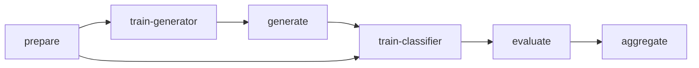

# Reproduction commands

## Execution status

The artifact-stage commands below are opt-in. Import and `--help` do not train a model. No stage
downloads data, vectors, or models. No stage starts another training stage.
The explicit `smoke` command is the exception: it requests the complete bounded
synthetic flow. Other stages never train a missing prerequisite.

Run all Python, tests, and model work through the approved Colab MCP session.
Do not execute these examples on the local host. The isolated locked Colab T4
environment uses Python 3.12.14, PyTorch 2.14.1+cu132, and CUDA 13.2. Its FP32
runtime CLI passed, all 258 reproduction tests passed in 44.56 seconds
(46.3809 seconds outer elapsed), and the seven-case CLI smoke passed in 7.041345411
seconds. Tests include API integration, CLI parse/dispatch, resume, and
fresh-process CUDA initialization regressions. See [runtime setup](runtime.md) and the
[acceptance report](acceptance-report.md) for versions, memory, and evidence.
These are historical acceptance results, not tests of the later checkpoint
policy or campaign runner. No new tests or full training are reported here.

Generator CLI resume passed from POG boundary 4 to boundary 20 in a fresh
process. Classifier epoch resume passed API tests; a separate classifier CLI
resume was not run. Colab Tesla T4 is the user-selected CUDA acceptance target.
Private paper datasets, full campaigns, and paper scores remain unverified.

The shell examples use `snip` to reduce output. `snip` is not a package
dependency. In a Colab code cell without `snip`, pass the same Python argument
list to the interpreter through the approved notebook execution path. Set
`UV_PROJECT_ENVIRONMENT` to the selected isolated environment. The final
acceptance used `/content/oos-detect-isolated-3ii_xbht-venv`.
Each example starts that environment's Python in a fresh process, not the
notebook kernel. Pass this variable explicitly to independent subprocess calls.

Use a recursive checkout with all three editable distributions installed in the
selected environment. See [runtime setup](runtime.md). Run manifests require
Git metadata for the root, POG repository, and nested GAN fork. A source-only
upload without that metadata is not sufficient for provenance collection.

## Stage boundaries



`MSP`, `Perturb`, and `Mix` do not use the generator stages. `POG` and `AEPOG`
require a completed generator run and a separate generated text artifact.
The two POG ablations use variant `POG` with mode `pog-no-noise` or
`pog-no-soft-token`. AEPOG requires variant `AEPOG` and mode `aepog`.

Each training command selects **one** `--seed`. The declared `--seeds` list is
campaign metadata, not a request to start all seeds. Paper mode requires seeds
0–9, 80 generator epochs, 30 classifier epochs, and the full model/data settings.
It requires a user-supplied GloVe 6B 100d file for each training stage. The choice
of GloVe is an engineering assumption, not a paper claim. See
[data and embedding provenance](data-protocol.md).

`--config FILE` loads validated JSON settings. Do not combine it with profile,
variant, mode, device, epoch, or campaign-seed overrides. The resolved config is
saved in each run. The output path must be new unless `--resume` is explicit.
CPU devices and missing CUDA fail; there is no CPU fallback.

## Bounded non-paper smoke

```bash
snip "$UV_PROJECT_ENVIRONMENT/bin/python" -m oos_detect.reproduce smoke --output artifacts/t4-smoke-001 --device cuda:0
```

This explicit command creates synthetic sources and prepared files. It runs all
five final classifier variants and both POG ablations. Each generator uses one
epoch, eight IND examples, batch size two, small hidden layers, and eight
exported records. All embeddings remain 100d but are random-only and labeled
non-paper. AEPOG includes its two additional unlabeled phase types. The smoke
includes second-order GP backward, generation, classifier updates, validation
selection, test reports, validation-only threshold calibration, and aggregation.
It records phase time, total time, runtime, and peak allocated CUDA memory.

The final isolated locked run wrote
`/content/clinc-isolated-acceptance-v6uctvej/smoke` and used
25,843,200 bytes peak allocated CUDA memory (about 24.65 MiB).
Use a new output path for another run.

The command does not run a full campaign. It does not demonstrate paper scores.
The separate isolated recursive-checkout acceptance verified locked installation
of all three editable packages with the implementation changes included. It was
not a clean published revision: source changes remain uncommitted.

## Independent commands

Prepare the full original CLINC sources without model execution:

```bash
snip "$UV_PROJECT_ENVIRONMENT/bin/python" -m oos_detect.reproduce prepare --output artifacts/clinc-paper --seed 0
snip "$UV_PROJECT_ENVIRONMENT/bin/python" -m oos_detect.reproduce runtime --device cuda:0
```

The preparation seed fixes shared Dmix membership. Reuse this prepared artifact
across campaign seeds so the reports have the same data identity. Its actual
seed, source hashes, vocabulary policy, and membership are in the manifest.
The classifier vocabulary in the paper profile uses held-out **text**, not
held-out labels. The generator vocabulary uses IND training text only.

One full paper POG run, with explicit epoch counts and declared campaign seeds:

```bash
common=(--prepared artifacts/clinc-paper --profile paper --variant POG --mode pog --device cuda:0 --generator-epochs 80 --classifier-epochs 30 --seeds 0 1 2 3 4 5 6 7 8 9 --seed 0)
snip "$UV_PROJECT_ENVIRONMENT/bin/python" -m oos_detect.reproduce train-generator "${common[@]}" --embeddings /content/glove.6B.100d.txt --output artifacts/POG/seed-0/generator
snip "$UV_PROJECT_ENVIRONMENT/bin/python" -m oos_detect.reproduce generate "${common[@]}" --generator-run artifacts/POG/seed-0/generator --output artifacts/POG/seed-0/generated
snip "$UV_PROJECT_ENVIRONMENT/bin/python" -m oos_detect.reproduce train-classifier "${common[@]}" --embeddings /content/glove.6B.100d.txt --generator-run artifacts/POG/seed-0/generator --generated artifacts/POG/seed-0/generated --output artifacts/POG/seed-0/classifier
snip "$UV_PROJECT_ENVIRONMENT/bin/python" -m oos_detect.reproduce evaluate "${common[@]}" --classifier-run artifacts/POG/seed-0/classifier --output artifacts/POG/seed-0/evaluation --calibrate
snip "$UV_PROJECT_ENVIRONMENT/bin/python" -m oos_detect.reproduce aggregate --reports artifacts/POG/seed-0/evaluation/summary.json --expected-seeds 0 1 2 3 4 5 6 7 8 9 --output artifacts/POG/partial-summary.json
```

The final line reports nine missing seeds. It does not invent their results.
Use a new aggregate output filename when more seed reports are available.

## Preferred campaign runner: first launch only

The approved campaign order is seed-major: all seven methods for seed 0, then
all seven for seed 1, through seed 9. This does not request all runs at once.
The first launch is **MSP seed 0 only**. Do not substitute POG or launch the
remaining methods or seeds with this first command.

The runner is under development. This is its planned module CLI, not an
executed or verified command. Use it only after the runner is ready in the
approved Colab runtime. `WORK_ROOT` is a local Colab SSD path; `BACKUP_ROOT`
is a dedicated mounted Drive path; `EMBEDDINGS` is the supplied GloVe file.

```bash
snip "$UV_PROJECT_ENVIRONMENT/bin/python" -m oos_detect.reproduce.campaign --experiment MSP --seed 0 --work-root "$WORK_ROOT" --backup-root "$BACKUP_ROOT" --embeddings "$EMBEDDINGS" --backup-seconds 600 --checkpoint-seconds 60
```

The campaign caller explicitly selects `checkpoint_interval_seconds=60` and
`retain_checkpoints=True`. See [checkpoint policy](checkpoints.md#operational-checkpoint-policy)
and [persistent run backups](persistence.md). Backups run with training paused,
at eligible completed checkpoints and at completion, not on a background timer.
Saving the notebook to Colab/Drive is not publication. Exclude the external
OpenSpec planning folder from publication.

## Deliberate full ten-seed campaign

**Legacy reference only: do not use this block to start or restart the campaign.**
Prefer the campaign runner above once it is ready. The `set -e` loops stop on
errors but do not provide safe restore/resume dispatch or Drive backups.
Rerunning them can collide with existing output directories. They request all
seven methods and ten seeds, not the approved MSP seed-0 first launch.
The stage commands use the backward-compatible defaults: every generator phase
is saved and all checkpoints are kept. No full-run duration or disk-capacity
claim is available. Check free GPU memory and disk capacity before training.

```bash
set -e
for seed in 0 1 2 3 4 5 6 7 8 9; do
  for variant in MSP Perturb Mix; do
    run="artifacts/$variant/seed-$seed"
    common=(--prepared artifacts/clinc-paper --profile paper --variant "$variant" --mode pog --device cuda:0 --generator-epochs 80 --classifier-epochs 30 --seeds 0 1 2 3 4 5 6 7 8 9 --seed "$seed")
    snip "$UV_PROJECT_ENVIRONMENT/bin/python" -m oos_detect.reproduce train-classifier "${common[@]}" --embeddings /content/glove.6B.100d.txt --output "$run/classifier"
    snip "$UV_PROJECT_ENVIRONMENT/bin/python" -m oos_detect.reproduce evaluate "${common[@]}" --classifier-run "$run/classifier" --output "$run/evaluation"
  done
  for mode in pog aepog pog-no-noise pog-no-soft-token; do
    variant=POG
    if [ "$mode" = aepog ]; then variant=AEPOG; fi
    run="artifacts/$mode/seed-$seed"
    common=(--prepared artifacts/clinc-paper --profile paper --variant "$variant" --mode "$mode" --device cuda:0 --generator-epochs 80 --classifier-epochs 30 --seeds 0 1 2 3 4 5 6 7 8 9 --seed "$seed")
    snip "$UV_PROJECT_ENVIRONMENT/bin/python" -m oos_detect.reproduce train-generator "${common[@]}" --embeddings /content/glove.6B.100d.txt --output "$run/generator"
    snip "$UV_PROJECT_ENVIRONMENT/bin/python" -m oos_detect.reproduce generate "${common[@]}" --generator-run "$run/generator" --output "$run/generated"
    snip "$UV_PROJECT_ENVIRONMENT/bin/python" -m oos_detect.reproduce train-classifier "${common[@]}" --embeddings /content/glove.6B.100d.txt --generator-run "$run/generator" --generated "$run/generated" --output "$run/classifier"
    snip "$UV_PROJECT_ENVIRONMENT/bin/python" -m oos_detect.reproduce evaluate "${common[@]}" --classifier-run "$run/classifier" --output "$run/evaluation"
  done
done
for experiment in MSP Perturb Mix pog aepog pog-no-noise pog-no-soft-token; do
  reports=()
  for seed in 0 1 2 3 4 5 6 7 8 9; do
    reports+=("artifacts/$experiment/seed-$seed/evaluation/summary.json")
  done
  snip "$UV_PROJECT_ENVIRONMENT/bin/python" -m oos_detect.reproduce aggregate --reports "${reports[@]}" --expected-seeds 0 1 2 3 4 5 6 7 8 9 --output "artifacts/$experiment/ten-seed-summary.json"
done
```

To request a partial report, pass only the explicit completed summary paths.
A missing path passed as an input is an error, not a silently skipped seed.

## Checkpoints and resume

Generator checkpoint files use `checkpoints/boundary-NNNNNNNNN.pt`. Repeated
critic and AEPOG steps have separate phase boundaries. The pipeline defaults
save every phase and keep all files. The campaign caller instead requests a
60-second interval and bounded retention. It saves at the first completed phase
after the interval, and always at epoch completion, an explicit stop, or
completion. This is not a strict wall-clock recovery guarantee.

`retain_checkpoints=True` preserves latest, selected, and final references where
applicable. Pruning removes only unreferenced files in the ownership ledger with
matching hashes. It does not overwrite checkpoint files or delete unrelated
files. See [checkpoint policy](checkpoints.md#operational-checkpoint-policy).
Keep active checkpoints on the local Colab SSD. Use the synchronous callback
for [Drive backups](persistence.md), with training paused during the copy.

Each checkpoint stores all models and optimizers, global Python/NumPy/CPU/CUDA
RNG state, named CUDA streams, temperature, policy baseline, trainer counters,
loader permutations/cursors, current batch IDs, and the next phase. IND batches
define a generator epoch; Dmix cycles independently. Each batch is reused for
the configured repeated phase updates. The training-noise stream uses
`derived_seed(seed + 2, "initialization")`; the independent Dmix loader uses
`derived_seed(seed + 1, "loader")`. Both are restored from checkpoint state.

Final CNN runs save full epoch checkpoints. Shorter IND and entropy loaders
cycle independently. At a completed epoch, both iterators are discarded; the
next epoch creates new permutations from saved loader RNG states. The selected
epoch uses best IND-validation accuracy with strict improvement, so ties retain
the earliest epoch. Both selected and final epoch files remain available.
Evaluation checks selection against the final checkpoint before test inference.

Resume requires the same config, embedding source, prepared data, entropy
artifact, and output directory. Name the latest completed checkpoint explicitly:

```bash
snip "$UV_PROJECT_ENVIRONMENT/bin/python" -m oos_detect.reproduce train-generator "${common[@]}" --embeddings /content/glove.6B.100d.txt --output artifacts/POG/seed-0/generator --resume artifacts/POG/seed-0/generator/checkpoints/boundary-000000123.pt
```

The earlier tiny acceptance resumed an API-created partial run through the fresh
generator CLI from boundary 4 to boundary 20. All five phase counts ended at
four, the phase log contained exactly 20 entries, and older checkpoint hashes
were unchanged. This verifies tiny POG generator CLI continuation, not a full
paper run or a separate classifier CLI resume. Classifier epoch continuation
passed API tests. See the [acceptance report](acceptance-report.md).

Here `common` must still be the matching seed-0 POG settings from the independent
command example, not values left by the campaign loop. For a CNN resume, use
`train-classifier`, the same entropy inputs, its output directory, and its latest
checkpoint. Do not replay an older boundary into a run with newer checkpoints.
Only load trusted checkpoints: they contain pickled optimizer and RNG objects.
An interruption before a completed checkpoint replays unsaved work. Arbitrary
mid-minibatch recovery and bitwise replay across platforms are not promised.
A phase log can miss its final entry if execution stops after checkpoint
publication but before log append; the checkpoint is the durable boundary.
The current resume code repairs that missing record from the saved checkpoint.
It also removes this stage's duplicate records and records beyond the saved
boundary, preserves unrelated lines, and rejects malformed JSON. Unsaved updates
can be repeated. These code changes are not covered by the historical results
above. Keep the matching checkpoint, policy ledger, and logs together on restore.

The final configured generator epoch is the only export candidate. Generation
samples at temperature one with an independent derived generation seed, bounded
empty-output retries, EOS stopping, and retained duplicates. Corpus and manifest
hashes must match before classifier training. No test metric selects a model.

### Generated token identity

The current exporter saves space-joined vocabulary tokens, not token IDs. The
pipeline reverses this join exactly, validates each generator token, and uses
the saved generator-to-classifier ID mapping. It does not re-tokenize `<unk>`
into punctuation. PAD/BOS/EOS strings are forbidden in exported content. For a
rollout at the length cap, all content IDs are kept and EOS is not forced.
Shorter output gets BOS/EOS and right padding. This policy is recorded in the
classifier run inputs. Original CLINC text still uses the normal tokenizer.

Exporter ablation/profile names are checked against the original hashed
manifest. The prerequisite validator receives an in-memory view with classifier
variant `POG` for POG ablations, but still requires the generation-stage profile
(`paper-generation` or `tiny-non-paper-generation`). Only the separate classifier
consumer view uses the experiment profile. The original manifest is preserved
in run inputs, so ablations cannot be mistaken for ordinary POG artifacts.
The adapted view names the original hash `export_manifest_sha256`; it does not
claim that the original hash covers renamed consumer fields.

## Reports and pending verification

Evaluation saves per-example probabilities, intent predictions, confidence,
`1-confidence`, source/status, selected checkpoint hash, and summary metrics.
It reports both IND/OOD-positive AUPR and FPR95/FPR90. Tied scores stay grouped.
Test ROC operating points are descriptive. `--calibrate` fixes a separate
validation-only OOD threshold before test prediction. Aggregation reports mean,
sample standard deviation, seed completeness, and provisional paper comparisons.
Reports also fix fingerprints for effective settings, embedding-source metadata,
source revision/dirty-state flags, and runtime. Aggregation rejects differences
in these identities instead of combining unlike runs.
See [metric definitions](metrics.md) for the paper's FPR ambiguity and AUPR
class-balance caveat.

The passed reproduction suite includes CLI parse/dispatch, prepared-file rejection,
all seven tiny API artifact flows, exact generated UNK mapping, phase/epoch resume,
policy-baseline and loader-cursor restoration, selection provenance, collision
protection, and missing-prerequisite failures. The focused test command is:

```bash
snip "$UV_PROJECT_ENVIRONMENT/bin/python" -m pytest tests/reproduction/test_cli.py tests/reproduction/test_pipeline.py
```

Generator CLI resume, the locked CLI runtime, and the seven-case smoke have
passed. A separate classifier CLI resume remains unverified; classifier epoch
resume passed API tests. Use the same approved Colab MCP execution path. Locked T4
results do not verify private paper datasets, full campaigns, or
paper scores.
Do not commit, push, edit planning checkboxes, or touch unrelated uploads as
part of these commands. Publication requires separate approval and inside-out
revision pinning: nested GAN, POG, then the root repository.
